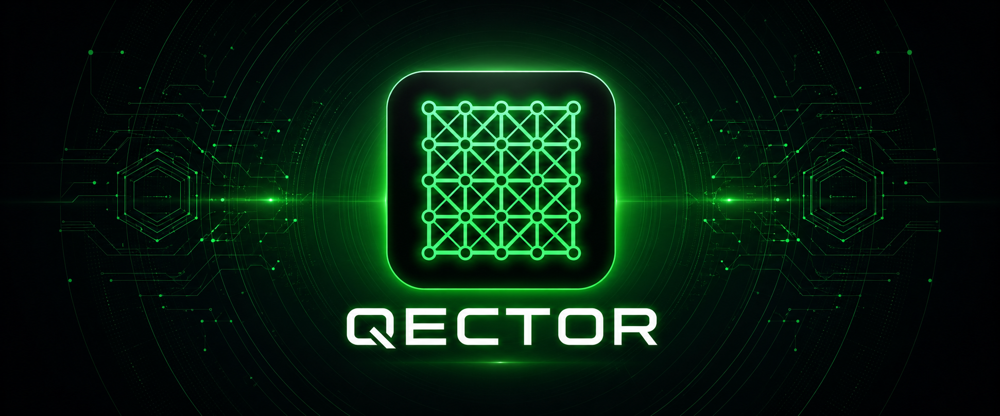

<p align="center">
  
</p>

<h1 align="center">QECTOR</h1>

<p align="center">
  <strong>Quantum error correction you can check, not just trust.</strong><br/>
  <em>Decoders, machine-checked proofs and open research data, by Guillaume Lessard (Longueuil, Québec).</em>
</p>

<p align="center">
  <a href="https://pypi.org/project/qector-decoder-v3/"></a>
  <a href="https://github.com/GuillaumeLessard/qector-claude-plugin"></a>
  <a href="https://doi.org/10.5281/zenodo.23956279"></a>
  <a href="https://zenodo.org/communities/id01t"></a>
</p>

<p align="center">
  <a href="https://www.qector.store">Website</a> ·
  <a href="#software">Software</a> ·
  <a href="#research">Research</a> ·
  <a href="#licensing">Licensing</a> ·
  <a href="#contact">Contact</a>
</p>

---

## What QECTOR is

QECTOR is an independent quantum error correction project. It builds decoding software that checks its own answers, and it publishes the evidence behind its results: proofs a computer has verified, data you can rerun, and checksums for every release.

The rule behind all of it: every correction a QECTOR decoder returns reproduces the syndrome, **H c = s (mod 2)**, or the call fails.

## Software

| Project | Latest | What it is |
|:--|:--|:--|
| [**QECTOR Decoder v3**](https://github.com/GuillaumeLessard/qector-decoder) | [1.0.1 on PyPI](https://pypi.org/project/qector-decoder-v3/) | Python library with a compiled Rust core: Union-Find, exact MWPM (Blossom), sparse Blossom, BP-OSD and Relay-BP for qLDPC codes, CPU and GPU batch decoding, Stim and Sinter integration. 18 wheels (CPython 3.9 to 3.14, Linux x86_64, Windows x64, macOS Apple silicon) with Sigstore build provenance and PyPI attestations. |
| [**QECTOR Claude Plugin**](https://github.com/GuillaumeLessard/qector-claude-plugin) | [2.0.1](https://github.com/GuillaumeLessard/qector-claude-plugin/releases) | Verified QEC decoding inside Claude Code and Claude Desktop: an air-gapped MCP server (12 tools by default, 41 in the research profile), schema-validated in both directions, with signed release manifests and `SHA256SUMS`. Pins `qector-decoder-v3==1.0.1`. |
| [**QECTOR Decoder Workbench**](https://github.com/qectorlab/qector-decoder-workbench-windows) | [1.0.7](https://github.com/qectorlab/qector-decoder-workbench-windows/releases/latest) | Free desktop application for Windows and [Linux](https://github.com/qectorlab/qector-decoder-workbench-linux): explore codes and Tanner graphs, run 19 decoders on 10 code families, export reproducible results. Ships an 85-tool MCP server. |
| [**qector-proof**](https://github.com/GuillaumeLessard/qector-proof) | certification suite | Executable checks of `qector-decoder-v3==1.0.0` against the Reference Manual v1.0.0, with a reproducible, hash-locked install. |

```bash
pip install qector-decoder-v3
```

## Research

Everything below is on Zenodo with a DOI, in the [QECTOR Research Archive](https://zenodo.org/communities/id01t). Each record states what kind of evidence it carries: machine-checked proof, computer-assisted proof, measured benchmark, or developer-run certification.

- **[[832, 10, 15]], machine-checked.** The genus5 GB CLEAN quantum LDPC code has 832 physical qubits, 10 logical qubits and minimum distance exactly 15. Coq 8.18 proves the whole result, lower bound included, with no axioms; Lean 4.19 and Isabelle2025-2 cross-check it. [Formal proofs](https://doi.org/10.5281/zenodo.23956279) · [verification bundle](https://doi.org/10.5281/zenodo.23463892)
- **Fold-and-lift.** An exact method for certifying the minimum distance of quasi-cyclic CSS codes whose circulant size carries a large power of two. For the [[832, 10]] code it runs in about one second per sector on one CPU core. [Paper](https://doi.org/10.5281/zenodo.23327681)
- **LCL-832 as a Metastable Effective Theory.** Every theorem of version 4.0 is machine-checked in Coq, using only the three standard axioms of Coq's real numbers. [Formal proofs](https://doi.org/10.5281/zenodo.23956600)
- **QECTOR Decoder v3 documentation.** [Reference manual](https://doi.org/10.5281/zenodo.22991962) · [verification report](https://doi.org/10.5281/zenodo.22991952) · [benchmark datasets](https://doi.org/10.5281/zenodo.22991940)

Verification was run by the author unless a record says otherwise. Independent rebuilds and reviews are welcome.

## Licensing

- **Papers, reports and data:** CC BY 4.0 unless a record says otherwise.
- **QECTOR software:** source-available under the PolyForm Noncommercial License 1.0.0. Free for personal, academic, educational and non-commercial research.
- **Commercial use** (company R&D, hosted services, redistribution) needs a licence: plans at [qector.store/pricing](https://qector.store/pricing). Licences are signed tokens verified offline, with no licence server.

## Contact

| | |
|:--|:--|
| **Website** | [www.qector.store](https://www.qector.store) |
| **Commercial Licensing** | [admin@qector.store](mailto:admin@qector.store) |
| **Support** | [admin@qector.store](mailto:admin@qector.store) |
| **Pricing** | [qector.store/pricing](https://qector.store/pricing) |
| **Research Archive** | [zenodo.org/communities/id01t](https://zenodo.org/communities/id01t) |

---

<p align="center">
  <strong>QECTOR</strong><br/>
  © 2026 Guillaume Lessard / iD01t Productions<br/>
  ORCID <a href="https://orcid.org/0009-0000-3465-3753">0009-0000-3465-3753</a><br/><br/>
  <em>Building reliable, verified tools for fault-tolerant quantum computing research.</em>
</p>
